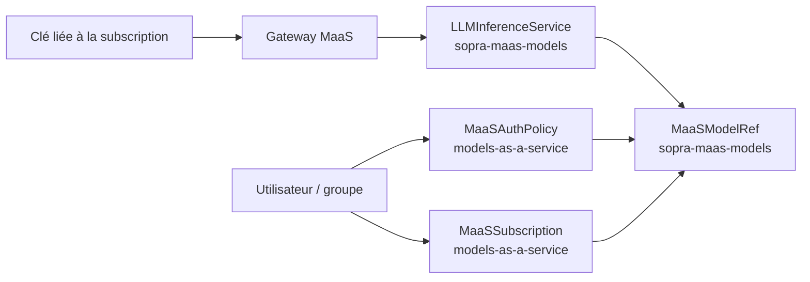
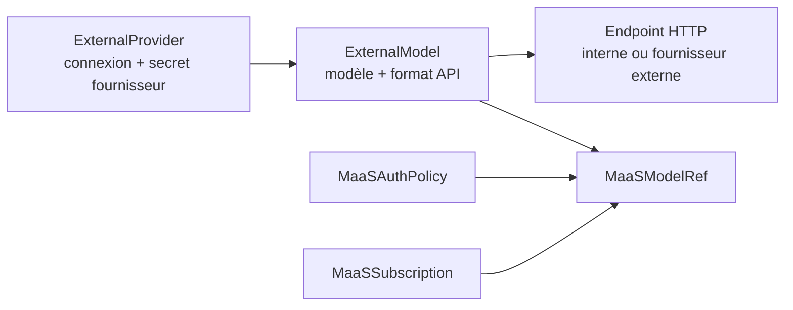

# Comprendre les deux chemins d'onboarding

## Modèle natif de cette démo

Le chemin natif évite `ExternalProvider` et `ExternalModel`. Il conserve les deux contrôles : `MaaSAuthPolicy` accorde l'accès au modèle ; `MaaSSubscription` fournit les limites d'utilisation. Il ne faut pas lire la gouvernance comme une chaîne où l'autorisation créerait automatiquement une souscription. Nos deux objets déclarent explicitement les mêmes références de modèle et les mêmes bénéficiaires. [Explication Red Hat des deux contrôles](https://www.redhat.com/ko/blog/models-service-maas-governance-managing-ai-access-and-token-quotas).

`MaaSSubscription` n'est pas une souscription commerciale Red Hat. Elle ne produit pas à elle seule une facture. Les CRDs installées sur notre sandbox exposent `tokenRateLimits`, `priority`, `billingRate` et `tokenMetadata` ; le kit renseigne uniquement les limites et la priorité. Une clé sélectionne `sopra-standard` ou `sopra-low` : choisir explicitement évite de confondre les deux quotas.

## Modèle accessible par endpoint HTTP

La compréhension du client correspond à ce chemin. « Externe » décrit ici le raccordement par endpoint, pas nécessairement un hébergement hors du cluster. Un `InferenceService` classique peut fournir ce backend, à condition que son protocole, son port et son authentification correspondent à la configuration du provider. Un service prédictif ONNX en protocole V2 ne devient pas automatiquement une API Chat Completions.

Les deux groupes API `maas.opendatahub.io` et `inference.opendatahub.io` exposent un kind `ExternalModel` sur la sandbox. Toujours qualifier le groupe API pour éviter de sélectionner l'ancienne CRD par ambiguïté. Les exemples optionnels ciblent `inference.opendatahub.io/v1alpha1` et ne sont pas appliqués par le setup natif.

## Organisation proposée

- `ai-tenants` : objets `AITenant`, gérés par les administrateurs plateforme.
- `models-as-a-service` : gouvernance du tenant par défaut ; policies et subscriptions de cette démo préfixées `sopra-`.
- `sopra-maas-models` : service de modèle et publication `MaaSModelRef`.
- `openshift-ingress` : gateway déjà provisionnée ; son nom réel est configuré, pas déduit d'une convention DNS.
- `redhat-ai-gateway-infra` : infrastructure observée sur la sandbox ; à redécouvrir sur chaque cluster.

Les références de gouvernance contiennent **nom et namespace** du modèle. Le label `maas.opendatahub.io/gateway-access=true` autorise l'attachement des routes à la gateway de cette sandbox. Ce label n'est pas un droit d'inférence pour un utilisateur.

Le kit utilise `view` dans le seul projet modèle pour son groupe humain. Il n'accorde aucun `admin` de projet ni lecture cluster-wide des services. En cas d'erreur du catalogue UI, conserver la réponse 403 et diagnostiquer le besoin RBAC exact avant d'élargir les droits. Le filtrage API et la visibilité UI sont deux vérifications distinctes.

## Tenant, groupe et isolation

Deux groupes dans `models-as-a-service` ne constituent pas deux tenants. Un `AITenant` supplémentaire nécessite une gateway propre et bootstrappe son namespace. Examiner `status.tenantNamespace` et `status.gatewayRef` au lieu d'inventer les noms. Le contrôleur et ses paramètres de découverte sont décrits dans la [référence amont](https://github.com/opendatahub-io/models-as-a-service/blob/main/maas-controller/README.md).

Le multitenant MaaS, l'observabilité MaaS et les modèles externes sont indiqués Technology Preview dans la documentation 3.5 consultée. Les modèles externes sont limités au tenant par défaut. Le dashboard de consommation est réservé aux administrateurs et vise le showback ; il ne garantit pas une facturation exacte. Ces limites empêchent de promettre une parité complète avec un portail de facturation. [Documentation produit 3.5, sections 1.18, 1.20 et 1.21](https://docs.redhat.com/en/documentation/red_hat_openshift_ai_self-managed/3.5/pdf/govern_llm_access_with_models-as-a-service/Red_Hat_OpenShift_AI_Self-Managed-3.5-Govern_LLM_access_with_Models-as-a-Service-en-US.pdf).

L'isolation d'API ne prouve pas l'isolation réseau : tester aussi l'accès direct au backend, les NetworkPolicies, le stockage, les secrets et les permissions Kubernetes. Cette session n'installe pas deux tenants et ne prétend donc pas certifier leur isolation.
